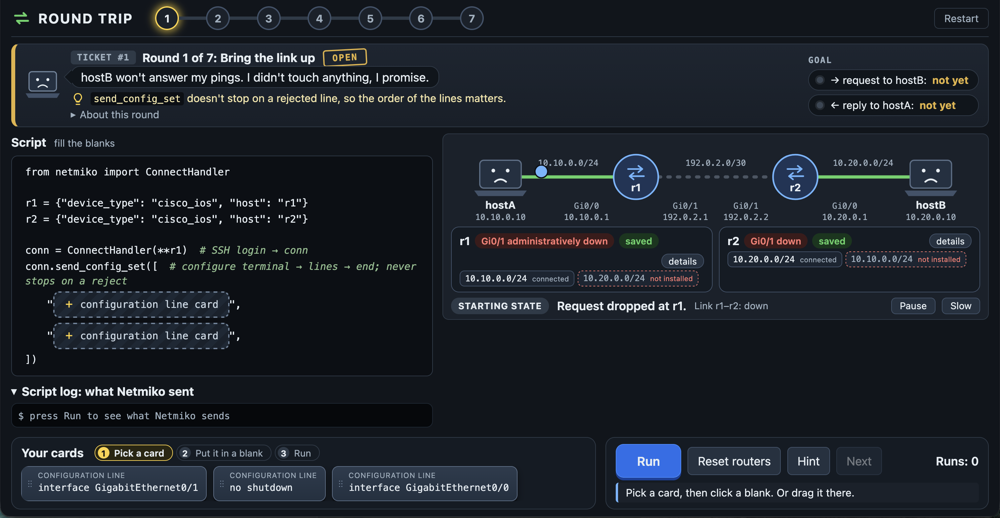

# Round Trip

**Finish the script, run it, and watch whether the ping makes it there and back.**



Round Trip is a browser game for network engineers who are new to automation. You place code cards into the blanks of a short Netmiko-style script, run it against two simulated routers, and watch a ping travel from hostA to hostB and back. Beside every call the script says what Netmiko does there, and after each Run the log shows what Netmiko actually sent to the router, what the router did with it, where the traffic stopped, and the rule behind it.

The misconception it targets: *a script that ran without crashing has fixed the network.* The game keeps three things apart: what the script sent, what the router holds in its configuration, and what traffic actually does.

A project from **NAF AC6 — Loop Engineering, Spec-Driven Development & the Future of VibeOps**.

| Project | Details |
| --- | --- |
| Status | Playable. Automated tests pass; browser checks were run by the build agent in headless Chrome. No person has yet played it through (see [Verification](#verification)) |
| Networking topic | Cisco IOS CLI context, static routes in both directions, running versus startup configuration, driven by Netmiko call names |
| Typical session | 10–20 minutes for all seven rounds (target; not yet measured with a first-time player) |
| Live demo | Not published |

## What was built

- Seven rounds, one mechanic: place cards, press Run. Each adds one skill of writing a script, and the last uses them all.
  1. **Bring the link up**: the order of lines in `send_config_set`, and a rejected line does not stop the script.
  2. **The other end**: a script only changes the router it connects to, so read which end is shut.
  3. **A route in each direction**: the reply is a separate packet and needs its own route.
  4. **Working is not the same as saved**: the ping works, both routers reload, the same ping fails.
  5. **Save on every router**: a call after a loop runs once, on the last router.
  6. **Calls in order**: you place the calls themselves. Use `conn` before connecting and Python stops the script.
  7. **The whole script**: the challenge. Every line of the loop is a blank; of 720 possible scripts, 4 work.
- **A script to take away.** After the last round the summary shows the script you assembled as real Netmiko code, with a login added, a Copy button, and six steps for trying it on your own network.
- **How Netmiko works, in place.** A short comment on each call's line says what Netmiko does (`# configure terminal → lines → end; never stops on a reject`). After a Run the script log is a terminal transcript of what Netmiko sent (`r1# configure terminal`, `r1(config)# no shutdown`, `r1(config-if)# end`, `r2# write mem`), with what the router did tagged on the line that caused it.
- **Few words.** The ping trace is a row of hops, and the explanation is a verdict, one line for where the traffic stopped, and each rule in a few words that opens to its full text.
- **A status bar and tickets.** A level track across the top shows the seven rounds, with a star for any solved on the first Run. Each round is a ticket from hostA, a small laptop with a face, and its goal is two lamps: *request reaches hostB* and *reply reaches hostA*. They light from the ping, and hostA cheers up when its reply comes back.
- **One board, no scrolling.** In a window of about 1100 by 720 or more the whole game fits the screen: the script on the left with a terminal under it, the network on the right, and your cards as a hand along the bottom beside Run. When a ping fails, the router where it stopped gets a bubble saying why. Smaller windows get the same parts and a scrolling page.
- **Three steps, always shown:** pick a card, put it in a blank, run the script. The current step is lit, blanks look like gaps, and a card can be clicked into place or dragged.
- **Router state in the diagram:** a card under each router shows its link state, its routes and whether it is saved. Pointing at a router, or its details button, pops up the configuration lines.
- No page to read before a round. The round's one idea sits above the script; a worked example, the model limits and the sources are one click away in "About this round".
- A ping that repeats on the diagram for the whole round and always stops where the simulator says it stops. **Pause** freezes it and **Slow** runs it at 0.4 of normal speed; both also act on a Run's playback.
- A script log, a text ping trace and an explanation after every Run, read top to bottom: what the router did, where the traffic stopped, the rule. Each of the three collapses, and stays as you left it.
- Skip, replay, Reset routers, a hint per round, a session summary and a confirmed restart. Nothing ever makes you wait for an animation.
- Keyboard operation, text for everything colour shows, reduced-motion support, and a layout that holds at 768 px.

There is no account, backend, real device or network call after the page loads. Progress lasts for the page session only.

## Run the game

From the repository root:

```sh
python3 serve.py
```

Open <http://127.0.0.1:8000>. `serve.py` is a few lines around Python's built-in server that tell the browser not to cache the game's files. Any static file server works, but one that allows caching (such as plain `python3 -m http.server`) can leave the browser with a mix of old and new files after the game changes; the page then says it could not start, and a reload without the cache (Cmd+Shift+R or Ctrl+Shift+R) fixes it. Playing needs only a browser and any static file server. Opening `index.html` straight from disk is not supported, because the page loads its modules and `data/rounds.json` over HTTP.

## Run the tests

```sh
node --test tests/
```

The tests need Node (v26.11.1 was used; any version with the built-in test runner should work). Playing does not need Node.

Expected: 110 tests pass. Every placement of every round is run against an expected result worked by hand: 37 listed cases across the six smaller rounds, ten named cases of the last round, and all 720 placements of the last round against a hand-written rule that never calls the simulator. A run that finds no tests is a failure.

| Suite | Establishes |
| --- | --- |
| `tests/simulator.test.js` | The 47 cases in `tests/cases.js`, which is copied by hand from the spec and never calls the simulator; that the listed cases are every placement of the six smaller rounds; the seven opening pings |
| `tests/whole-script.test.js` | All 720 placements of *The whole script* against a hand-written rule for crashed, first ping and solved; exactly four scripts work |
| `tests/content.test.js` | `data/rounds.json` validates; nine broken variants are each rejected, with the round named where one is at fault; the take-away script, line by line |
| `tests/state.test.js` | Counting, single completion, replay during playback, card lock, Reset routers, hint, first-run mark, Next, summary, restart |
| `tests/feedback.test.js` | The sentences the acceptance criteria require, per-router trace lines, what Netmiko sent on each line, no router quotation until captured |

## The model and its limits

A simplified model of Cisco IOS behaviour, driven by Netmiko method names. It is a simulator: no real device, remote session or Python interpreter is involved.

```text
hostA ───────── r1 ═══════════ r2 ───────── hostB
10.10.0.10   Gi0/0  Gi0/1   Gi0/1  Gi0/0   10.20.0.10
             10.10.0.1  192.0.2.1  192.0.2.2  10.20.0.1
   10.10.0.0/24        192.0.2.0/30        10.20.0.0/24
```

The nine rules, with their wording, live in `data/rounds.json` under `rules`:

1. **CLI context.** `no shutdown` and `shutdown` are accepted only after an `interface …` line in the same `send_config_set` call.
2. **Link state.** The r1–r2 link is up only when `Gi0/1` is enabled on both routers.
3. **Route installation.** A static route is in the routing table only if its next hop is inside a connected subnet whose link is up.
4. **Own address.** The router rejects a static route whose next hop is one of its own addresses.
5. **Forwarding.** Each router forwards on the route that contains the destination; with none, the packet is dropped there. The reply is a separate packet.
6. **Persistence.** `save_config()` copies running to startup. A reload replaces running with startup.
7. **Loop variables.** After a `for` loop, `conn` is the last connection only.
8. **Silent rejection.** When the router rejects a line, `send_config_set` records the message and carries on.
9. **Script errors.** A call that uses `conn` before `ConnectHandler` has run is a NameError: Python stops the script there and nothing after it runs.

**Not simulated:** ARP, dynamic routing, administrative distance, equal-cost paths, recursive next-hop resolution, exit-interface static routes, IPv6, enable/privilege modes, closing sessions, authentication failures, timeouts, output parsing and ICMP error messages. There is no default route. Static routes install and withdraw instantly; a real router can take up to about a minute.

### References (checked 2026-11-17)

| Reference | Supports |
| --- | --- |
| Netmiko source, [`base_connection.py`](https://github.com/ktbyers/netmiko/blob/develop/netmiko/base_connection.py), `send_config_set` | Rule 8 |
| Netmiko source, [`cisco/cisco_ios.py`](https://github.com/ktbyers/netmiko/blob/develop/netmiko/cisco/cisco_ios.py), `save_config` | Rule 6 |
| Netmiko source, [`cisco_base_connection.py`](https://github.com/ktbyers/netmiko/blob/develop/netmiko/cisco_base_connection.py): `config_mode` sends `configure terminal`, `exit_config_mode` sends `end`; `send_config_set` calls them first and last. `cisco_ios.py`, `session_preparation`: `terminal width 511` and `disable_paging` | What Netmiko sends, as shown in the log |
| Netmiko API documentation, [`netmiko.base_connection`](https://ktbyers.github.io/netmiko/docs/netmiko/base_connection.html) | The call names |
| Cisco, [IP Routing Configuration Guide, IOS XE 17.17 (Catalyst 9600), Protocol-Independent Features](https://www.cisco.com/c/en/us/td/docs/switches/lan/catalyst9600/software/release/17-17/configuration_guide/rtng/b_1717_rtng_9600_cg/protocol_independent_features.html) | Rule 3 |
| Cisco, [IOS IP Routing: Protocol-Independent Command Reference, `ip route`](https://www.cisco.com/c/en/us/td/docs/ios/iproute_pi/command/reference/iri_book/iri_pi1.html) | Rule 3 and the timing note |
| Cisco, [Using the Command-Line Interface, Catalyst 9300, IOS XE 17.17](https://www.cisco.com/c/en/us/td/docs/switches/lan/catalyst9300/software/release/17-17/command_reference/b_1717_9300_cr/using_the_command_line_interface.html) | The wording of the two CLI error messages |
| Cisco Learning Network, [thread 46334](https://learningnetwork.cisco.com/thread/46334) | Rule 4. A forum post, not Cisco documentation |
| Cisco, [Configure Route Selection for Routers](https://www.cisco.com/c/en/us/support/docs/ip/enhanced-interior-gateway-routing-protocol-eigrp/8651-21.html) (Document ID 8651) | Rule 5, the forwarding choice |
| IETF, [RFC 1812](https://www.rfc-editor.org/rfc/rfc1812.txt), section 5.2.4.3 | Rule 5, the drop when no route matches. A standards document, not Cisco documentation |
| Python, [Language Reference, 8.3 "The `for` statement"](https://docs.python.org/3/reference/compound_stmts.html#the-for-statement) | Rule 7 |
| Python, [Library Reference, `NameError`](https://docs.python.org/3/library/exceptions.html#NameError) (checked 2026-11-19) | Rule 9 |
| Netmiko source, `base_connection.py`: `BaseConnection.__init__` takes `host`, `username`, `password`, `device_type`; `disconnect` closes the session (checked 2026-11-19) | The take-away script and its next steps |

### Known limits

- **Rules 1 and 2 are unsourced.** No reference has been found for the claim that `no shutdown` is rejected at global configuration level, or for rule 2.
- **Rule 4 is community-sourced only** (a forum post).
- **Two router messages are not captured from a real device**, so feedback paraphrases them and never shows them as quotations: `no shutdown` at global configuration level (expected `% Invalid input detected at '^' marker.`, possibly `% Incomplete command.` on some platforms), and a static route pointing at the router's own address (expected `%Invalid next hop address (it's this router)`). To ship one as a quotation, capture it, set its text and `"captured": true` under `routerMessages` in `data/rounds.json`, and rerun the tests.
- **The rule check has not been done.** Each rule still has to be checked against its reference in a pass separate from the build (a self-check, since the project has one author).
- **The take-away script has not been run against Netmiko.** It compiles as Python, and every call and parameter in it was checked against Netmiko's source, but Netmiko was not installed on the build machine and no real router was involved.
- **Only one script error is modelled:** using `conn` before connecting. Failed logins and timeouts are not.
- **The paging command is not named.** Netmiko's `session_preparation` calls `disable_paging`; the command that sends was not confirmed in the source, so the log says "turns off paging" without quoting it.
- **A collapsed panel is silent to a screen reader.** Text added to a panel the player has collapsed is not announced; the status line still reports each Run's result.
- **Below 768 px wide** the page falls back to one column and has not been checked.
- **Touch input has not been checked.**
- **No accessibility certification is claimed.** What was checked is listed below.

## Verification

Recorded 2026-11-17 on macOS (Darwin 25.6.0), Node v26.11.1, headless Chrome 157.

The checks were run on the first build and rerun as the game changed. After the game grew to seven rounds (2026-11-19), the agent reran: a keyboard-only playthrough of all seven rounds, Pause, replay and a cancelled restart during the last round's playback, reduced motion, the 768 px layout on the last round, drag and drop, the content-error view, and the new checks 30 to 33. Rows for checks that were not rerun on seven rounds describe the last time they were run.

**Who ran what.** Every result below marked *agent* was run by the coding agent that built the game: the unit tests under Node, and the page driven by script in headless Chrome (real clicks, real key events, real DOM, screenshots reviewed). That is not a person playing. The **Author** column is for the author's own check, which the project's constitution requires to be recorded as a self-check; none has been run yet.

`node --test tests/`: **110 tests, 110 pass, 0 fail** (2026-11-19). 47 of 47 listed cases match, with cases 1, 7, 11, 14, 15, 20, 32, 38 and 39 solved; 720 of 720 placements of the last round match the hand-written rule, with exactly 4 solved.

### Acceptance criteria

| AC | Result (agent) | Evidence | Author (self-check) |
| --- | --- | --- | --- |
| AC1 opens on round 1's play screen | Pass | Browser: idea above the script, a note beside each call, cards usable at once. `state.test.js` | Not run |
| AC2 solving placement, round 1 | Pass | Browser: link lit, trace "Request delivered to hostB. Reply delivered to hostA.", explanation. Case 1 | Not run |
| AC3 wrong order, round 1 | Pass | Browser: rejected line named, "carried on without stopping", dropped at r1, retry possible. Case 2 | Not run |
| AC4 Run with an empty slot | Pass | Browser: guidance names the slot, Runs: 0. `state.test.js` | Not run |
| AC5 lines highlight in order, state marked, then the trace | Pass | Browser: running line moved 0 → 1.0 → 1.1, changed rows tagged, trace after | Not run |
| AC6 hint | Pass | Browser: opens, recorded in the summary, round not solved. Validator rejects a hint containing a card's text | Not run |
| AC7 run counter; completes once | Pass | Browser: counter +1 at the press; replay counts nothing; Run disabled once playback ends. `state.test.js` | Not run |
| AC8 Next and the summary | Pass | Browser: next round opens on its play screen; summary with runs, hint use and first-run mark | Not run |
| AC9 Restart confirm and cancel | Pass | Browser: Cancel keeps the session; Confirm returns to round 1 | Not run |
| AC10 focus, names, keyboard | Pass | Browser: all seven rounds completed with focus and key events only; Tab order; focus ring; accessible names | Not run |
| AC11 text log and trace; reduced motion | Pass | Browser with reduced motion emulated: log, trace and feedback at once, same text. Screen-reader output itself was not listened to | Not run |

### Manual checks (`specs/001-round-trip-game/quickstart.md`)

| # | Check | Result (agent, headless Chrome) | Author (self-check) |
| --- | --- | --- | --- |
| 1 | Fresh load opens on round 1's play screen | Pass | Not run |
| 2 | Round 1 solved | Pass | Not run |
| 3 | Round 1 wrong order | Pass | Not run |
| 4 | Card change after a failed Run | Pass | Not run |
| 5 | Run with an empty slot | Pass | Not run |
| 6 | Select, place, return, swap: motion and a status sentence | Pass for the sentences. Motion classes are applied; the motion itself was not watched | Not run |
| 7 | Skip | Pass | Not run |
| 8 | Hint, then About this round | Pass | Not run |
| 9 | *A route in each direction*, worked interaction | Pass | Not run |
| 10 | *Working is not saved* with `print("done")` | Pass | Not run |
| 11 | Summary | Pass | Not run |
| 12 | Restart cancel, then confirm | Pass | Not run |
| 13 | All seven rounds, keyboard only | Pass by script (focus and key events). Not a person at a keyboard | Not run |
| 14 | Reduced motion | Pass (emulated) | Not run |
| 15 | 768 px wide | Pass: two columns, every button in view, no sideways scroll | Not run |
| 16 | Reload mid-session | Pass | Not run |
| 17 | Fresh clone, README only | **Not run** (the work is not committed yet) | Not run |
| 18 | Touch | **Not run** | Not run |
| 19 | Interruptions during a Run | Pass | Not run |
| 20 | The repeating ping | Pass: dot positions sampled; never passes the router where the packet is dropped; only the after-reload ping repeats in round 3 | Not run |
| 21 | Reset routers | Pass | Not run |
| 22 | Run during and after a solving playback | Pass | Not run |
| 23 | Pause and Slow | Pass: a dot paused mid-flight held its position for 1.2 s and moved on at Resume; a pass took 542 ms at normal speed and 1355 ms slow; a Run pressed while paused was counted at once and stayed frozen until Resume | Not run |
| 24 | Collapsible panels | Pass: three panels (Router state has moved into the diagram); each collapses to its heading, stays collapsed through a Run, and reopens from the keyboard | Not run |
| 25 | Netmiko notes and sent lines | Pass | Not run |
| 26 | Step strip, blanks, drag and drop | Pass: steps lit 1, 2, 1, 3; a card dragged with synthetic drag events landed in its blank. A real mouse drag was not tried | Not run |
| 27 | Router cards and the pop-up | Pass: state readable without hover; pop-up on pointer over the router; details pinned from the keyboard and kept through a Run; route used lit on the card | Not run |
| 28 | Less text | Pass: idea 25 words in round 1; one line per call note; explanation without the per-line list | Not run |
| 29 | Status bar, tickets and goal lamps | Pass: lamps off/off in round 1 and on/off in round 2 at the start; lit then dark across the reload in round 3; ticket stamped Resolved and the track starred only after the solving Run finished playing | Not run |
| 30 | *The other end* | Pass: the wrong router gives "accepted, and nothing changed"; the right one solves it | Not run |
| 31 | *Calls in order* | Pass: the crashed line is marked and stays marked; saved-too-early fails at the reload; connect, configure, save solves it | Not run |
| 32 | *The whole script* | Pass: four kinds of failure each explained by the right rule, then solved | Not run |
| 33 | The take-away script | Pass: matches what was placed; login lines highlighted; Copy falls back to selecting the text in headless Chrome; the text compiles as Python | Not run |
| 34 | Fewer words | Pass: after a failed Run, 318 words on screen in round 1 (was 496) and 486 in the last round (was 748); the rejected line, the hops and the one-line reason are all visible without hovering; rules open to their full text from the keyboard | Not run |
| 35 | One board | Pass: no page scroll at 1280×800 and 1440×900 in rounds 1 and 7, before and after a failed Run, and through a keyboard-only playthrough of all seven rounds; 1366×650 scrolls with the script still beside the network; 768 wide is one column with no sideways scroll | Not run |

### Still to do before release

| Item | Status |
| --- | --- |
| SC-003: a first-time player finishes in 5–10 minutes | Not run. The author is not a first-time player |
| SC-004: the author completes all seven rounds with the keyboard only | Not run |
| SC-006: the author names the rejected line, the stop and the rule from the feedback alone | Not run |
| SC-007: each rule checked against its reference, in a pass separate from the build | Not run |
| Capture the two router messages | Not done; listed above as a known limit |
| Find sources for rules 1 and 2 | Not done; listed above as a known limit |

### Content and logic are separate (constitution VI)

Checked by the agent on 2026-11-17:

- **One round's data.** *A route in each direction* in `data/rounds.json` holds its starting configuration, script, tray, briefing and hint, and no answer.
- **One placement traced.** Case 8 (`r1` with the route to 10.20.0.0/24): `run` returns the step `route-already-present` and a reply leg dropped at r2 with `drop-no-route`; `engine/feedback.js` turns those into "r1 already had this route, so nothing changed." and "r2 dropped the packet. It has no route to 10.10.0.0/24."
- **A trial round.** On the first build, a fifth round (r2's side of the link shut; one router slot and two configuration-line slots) was added to a copy of the content. It validated with no errors, and of its four placements exactly one solved it, with no change to `engine/simulator.js`. That round later became *The other end*, added as data alone. *Calls in order* and *The whole script* did need a simulator change, because they introduced rule 9.

## Layout

```text
index.html, style.css, main.js   The page, its styles, and the wiring
engine/simulator.js              The nine rules: run, startView, openingPing. Decides every outcome, and records what Netmiko sends
engine/content.js                Validates data/rounds.json before anything is shown
engine/state.js                  The session: counting, completion, hint, restart
engine/feedback.js               Turns a result into log lines, trace sentences and the explanation
ui/render.js, ui/diagram.js      Views and the topology diagram
ui/playback.js                   Timing: plays a Run step by step, keeps the ping repeating, Pause and Slow
data/rounds.json                 Topology, sources, rules, call notes, feedback wording and the seven rounds
tests/                           The hand-written cases, the hand-written rule for the last round, and five test suites
specs/001-round-trip-game/       Spec, plan, contracts and tasks
```

To change a round or its wording, edit `data/rounds.json`. A new round that uses the existing statements needs only data and its hand-worked cases.

## Licence

See [LICENSE](LICENSE).
